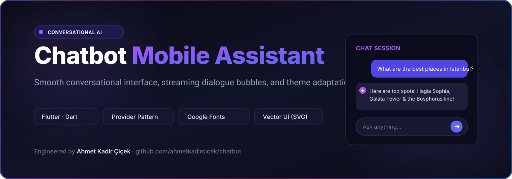
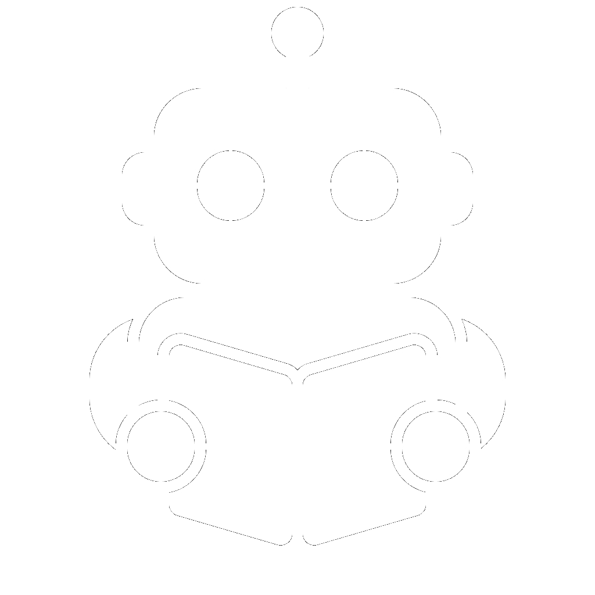

# Chatbot — Conversational AI Mobile Assistant

<div align="center">



### Modern conversational AI interface with streaming dialogue bubbles and theme adaptation built with Flutter.

[](https://flutter.dev)
[](https://dart.dev)
[](https://pub.dev/packages/provider)
[](https://pub.dev/packages/flutter_svg)
[](https://pub.dev/packages/google_fonts)
[](LICENSE)

<br/>

<p align="center">
  
</p>

</div>

---

## 🤖 Overview

**Chatbot** is an AI conversational assistant client built with Flutter. It focuses on delivering a responsive messaging experience with natural chat bubbles, Markdown-style formatting, real-time typing indicators, customizable dark/light ambient themes, and seamless keyboard handling.

Designed as an extensible client for large language model backends (Gemini, Claude, OpenAI), Chatbot features clean state separation via Provider and modular widget hierarchies.

---

## ✨ Features

- **Fluid Chat Flow**: Auto-scrolling message streams with differentiated user and AI bubbles, timestamps, and copy shortcuts.
- **Provider State Management**: Decoupled `ChatbotViewModel` managing asynchronous message delivery, loading states, and error retries.
- **Atmospheric Backgrounds**: Custom layered vector backgrounds (`assets/bg.png` and SVG filters) with smooth transitions.
- **Dynamic Theming**: Fine-tuned Material 3 typography with `google_fonts` and contrast-aware color tokens.
- **Cross-Platform Ready**: Compiles cleanly across iOS, Android, and Flutter Web.

---

## 🏛️ Project Structure

```
lib/
├── core/
│   └── theme/            # AppTheme, color definitions, typography styles
├── features/
│   └── chatbot/
│       ├── model/        # MessageModel (role, content, timestamp, status)
│       ├── view/         # ChatbotView (scaffold, appbar, message list, input bar)
│       ├── viewmodel/    # ChatbotViewModel (Provider state logic & API hooks)
│       └── widget/       # BackgroundWidget, ChatbotWidget, ChatBubbleWidget
└── main.dart             # App bootstrap & MultiProvider initialization
```

---

## 🚀 Getting Started

### Prerequisites
- Flutter SDK `^3.6.2` (Dart `^3.6.2`)

```bash
# 1. Clone repository
git clone https://github.com/ahmetkadircicek/chatbot.git
cd chatbot

# 2. Install dependencies
flutter pub get

# 3. Launch the app
flutter run
```

---

## 👨‍💻 Author

**Ahmet Kadir Çiçek**
- Website: [ahmetkadircicek.com.tr](https://ahmetkadircicek.com.tr)
- GitHub: [@ahmetkadircicek](https://github.com/ahmetkadircicek)
- LinkedIn: [in/akadircicek](https://www.linkedin.com/in/akadircicek)

---

## 📄 License

This repository is licensed under the [MIT License](LICENSE).
